# What can a camera capture beyond images?

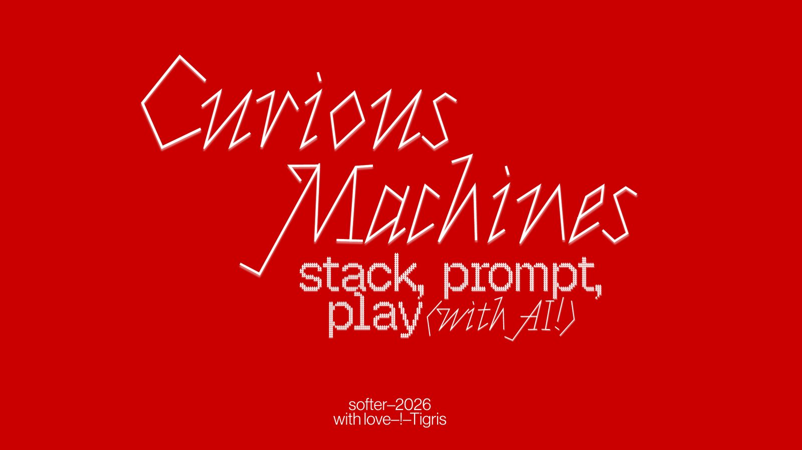

What could a screen, a camera, and a tiny computer become in your hands?

This first project is about giving your ideas physical form. You'll combine a Raspberry Pi, a touchscreen and a camera module (around £150 of parts), then use Claude Code to bring your own concepts to life. No soldering or coding experience is needed.

Just because we have the parts for a camera, doesn't mean it just has to take pictures - it could be a camera that **pixelates** your face, tells you have fast a Londoner is walking, or maybe it's a Berghain bouncer!

It's a chance to play, experiment, and surprise yourself with what your imagination can bring to life!

---

## What you'll need

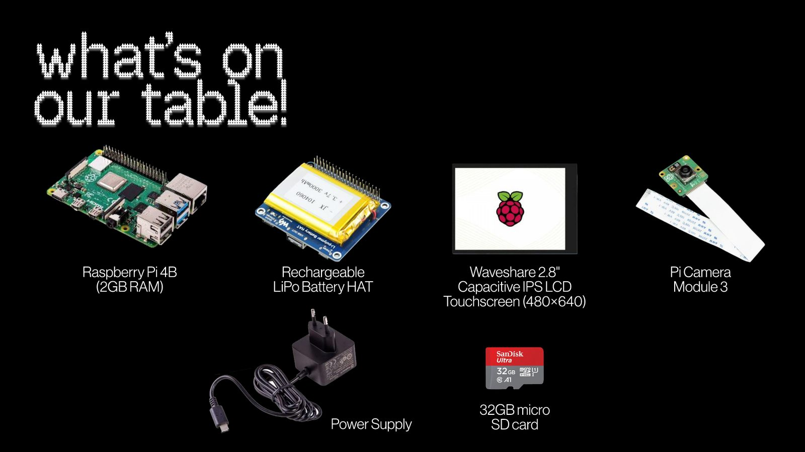

| Part | Roughly |
|---|---|
| Raspberry Pi 4 (2GB or more) | £55 |
| Waveshare 2.8" DPI touchscreen (480×640) | £34 |
| Raspberry Pi Camera Module 3 | £25 |
| Rechargeable LiPo battery HAT | £18 |
| 32GB microSD card (A1 rated) | £9 |
| USB-C power supply (5V/3A) | £9 |

Any camera module will work. Any screen will work too, but the setup script configures this particular Waveshare one — if yours is different, skip that part and tell Claude which screen you have instead.

The battery HAT is optional. It's what lets you unplug the thing and carry it around at the end, which is honestly the best bit.

---

## 1 · Flash the SD card

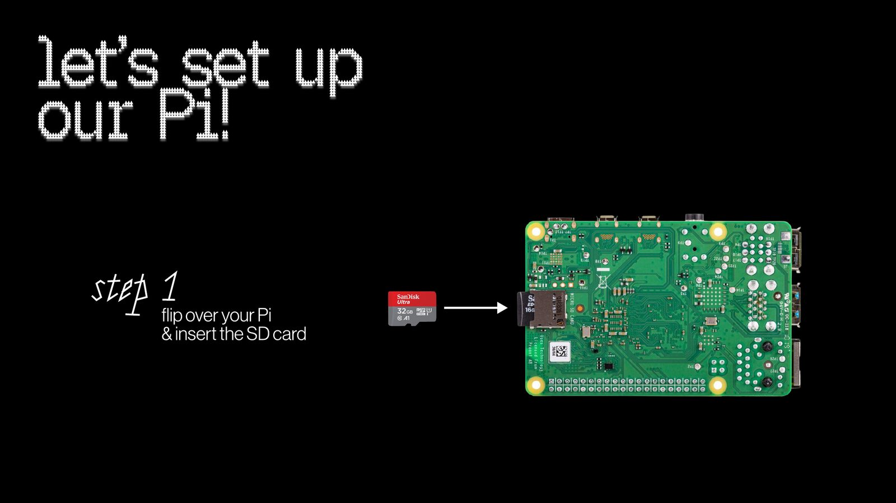

Download **Raspberry Pi Imager** and choose **Raspberry Pi OS (64-bit)**.

Before you hit write, open the settings (the gear icon) and fill in:

- **Hostname** → `camera`
- **Enable SSH**, with password authentication
- **Username and password** → you'll need these in a minute
- **Your wifi name and password**

Don't skip this screen! It's how you connect to your Pi from you computer.

---

## 2 · Stack it together

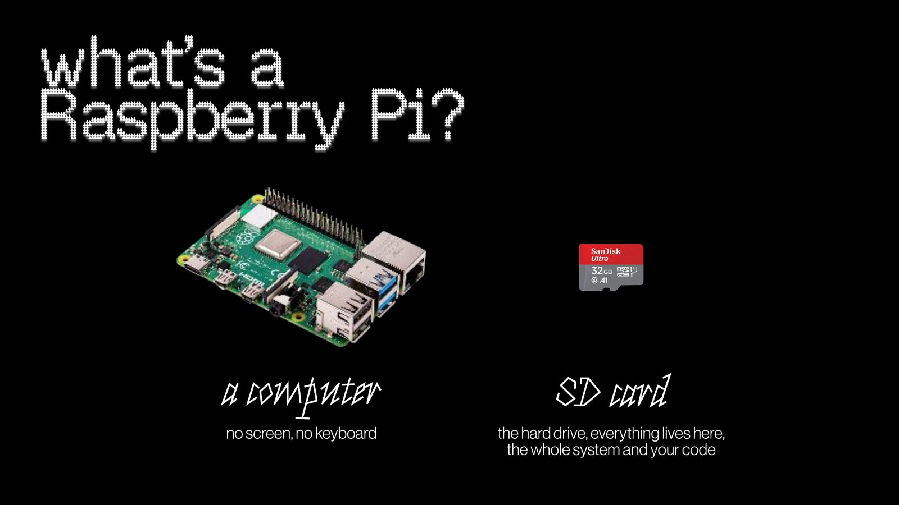

A Raspberry Pi is a whole computer with no screen and no keyboard. Everything lives on that little SD card — the system, and whatever you make.

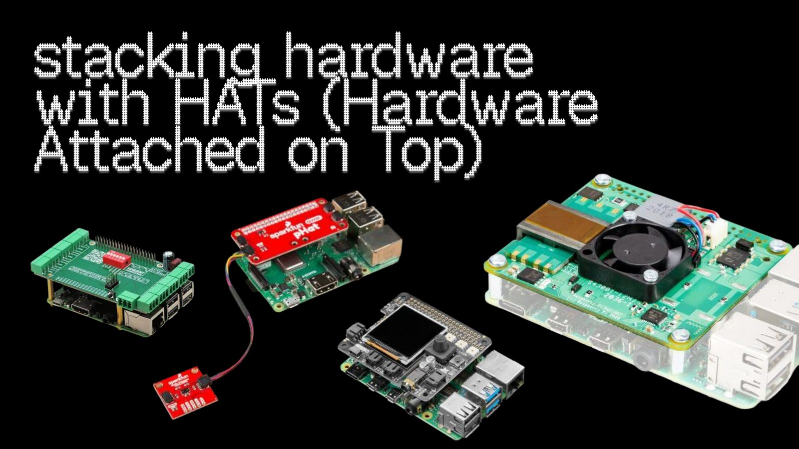

Boards that sit on top of it are called HATs — Hardware Attached on Top. They push onto the 40 pins along the edge, and each one passes the pins through so another board can sit above it.

**Build everything before you plug anything in.** Never add or remove a board while it's powered.

### The camera ribbon

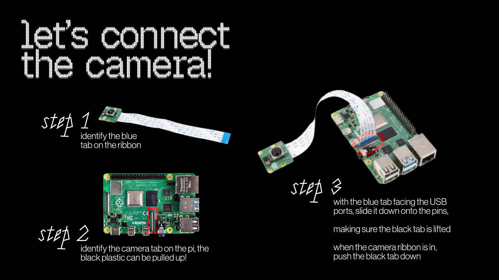

Find the blue tab on the ribbon. Lift the black clip on the Pi's camera connector, slide the ribbon in with the blue tab facing the USB ports, then press the clip back down.

### The battery HAT

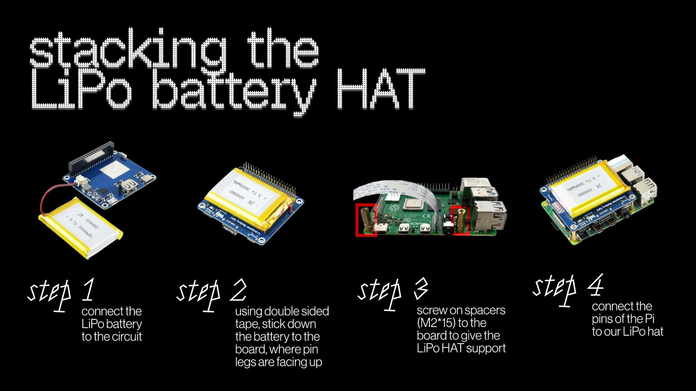

Connect the battery to the board, stick it down with double-sided tape, screw on the spacers, then press the whole thing onto the Pi's pins.

### The touchscreen

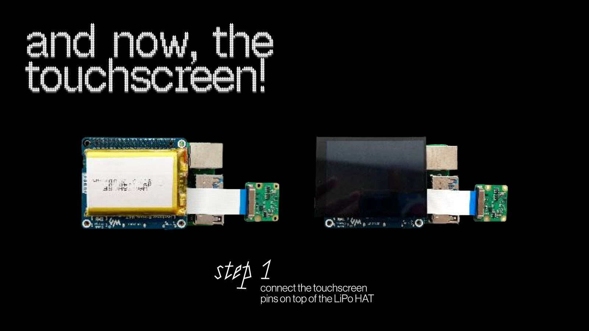

Onto the pins poking through the top of the battery HAT. Press down evenly until it sits flat — if it's at an angle or offset by a row, the screen won't come on.

### Then power

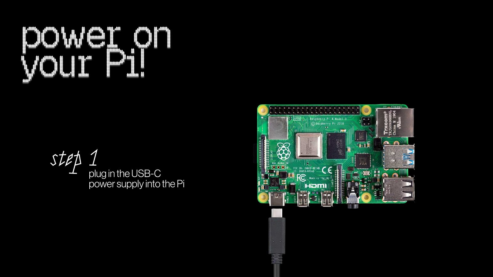

SD card in, then plug into the wall. Power always last.

Leave the battery switched off while you're building. It's for later, when you take it walking.

---

## 3 · Get in from your laptop

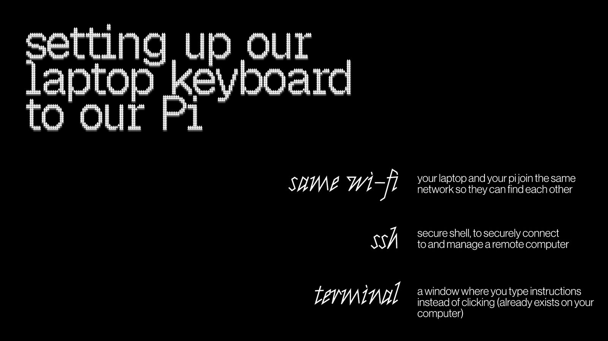

Your laptop becomes the keyboard. Open Terminal (Mac) or PowerShell (Windows) and type:

```bash
ssh pi@camera.local
```

The first time, it'll ask whether you're sure you want to connect — type `yes`, the whole word.

Then your password. **It won't show anything as you type it.** That's normal, not broken.

> **On Windows,** `camera.local` sometimes doesn't resolve. Use the Pi's IP address instead — it's printed on the little screen when it boots.

Everything you type from here happens on the Pi, not on your laptop. You can tell by the prompt: it'll say `pi@camera` instead of your own name.

---

## 4 · Run the setup script

```bash
git clone https://github.com/tigrisli/curious-machines.git
cd curious-machines/01-camera
bash setup.sh
```

It installs Node, the camera library, compressed swap (so a 2GB Pi stays happy), boots to the terminal instead of the desktop, reserves memory for the camera, and turns the screen on. Takes about ten minutes.

Have a read first if you like — `less setup.sh`. It's worth being in the habit of looking at scripts before you run them.

Then:

```bash
sudo reboot
```

---

## 5 · Install Claude Code in the Pi

SSH back in after the reboot:

```bash
ssh pi@camera.local
```

then, install Claude Code:

```bash
sudo npm install -g @anthropic-ai/claude-code
claude
```

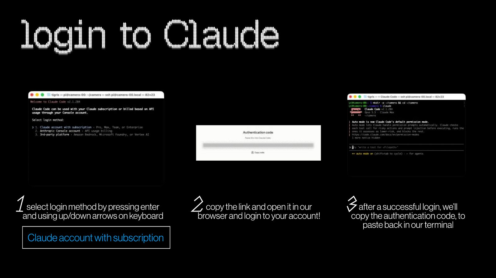

It'll ask you to log in. Choose the account option, copy the link it gives you, open it in your browser, and paste the code back into the terminal.

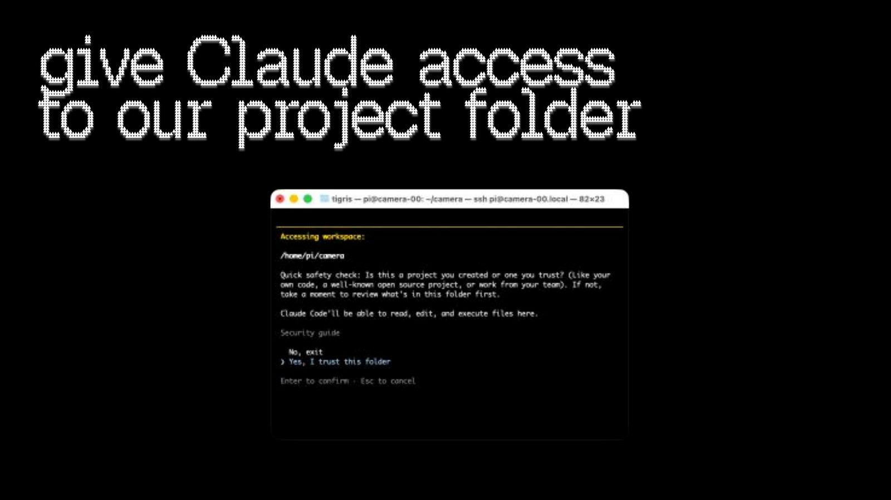

Then it asks whether it can work in this folder. Say yes — it's your Pi, and that folder is where your camera is going to live.

Claude Code is now running *inside* the Pi. It can read your files, write code, and run it for you.

---

## 6 · Wake up the camera

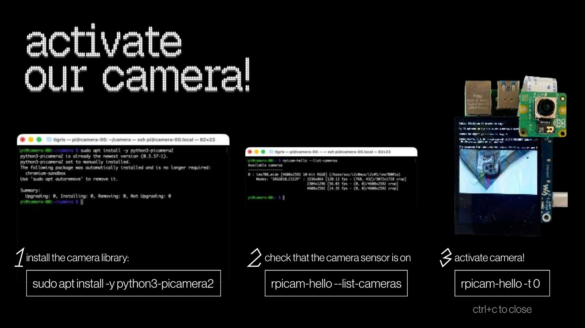

Before writing anything, let's check the camera is actually alive:

```bash
rpicam-hello --list-cameras
```

You should see your sensor listed — `imx708` for a Camera Module 3.

```bash
rpicam-hello -t 0
```

A live picture, straight onto the little screen. `ctrl+c` when you've had enough.

No code yet. We're just checking the eye opens.

---

## 7 · Make your camera

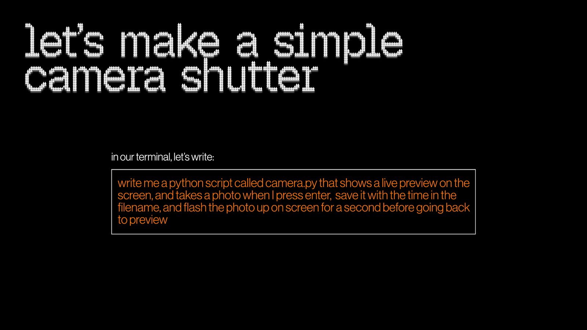

Now the fun part. Start Claude Code and ask for what you want:

```
write me a python script called camera.py that shows a live preview on the
screen and takes a photo when I press enter — save it with the time in the
filename, and flash the photo up on screen for a second before going back
to preview
```

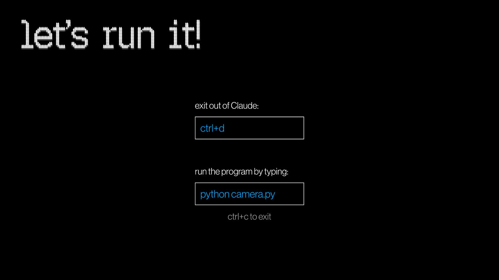

Claude can run it for you — just say "run it" — or you can do it yourself:

| | |
|---|---|
| `ctrl+c` | stops whatever's running |
| `ctrl+d` | leaves Claude, back to the plain prompt |
| `python camera.py` | runs your camera |
| `claude --continue` | back to Claude, same conversation as before |

That last one matters: plain `claude` starts a fresh conversation and won't remember your camera.

---

## 8 · Now make it strange

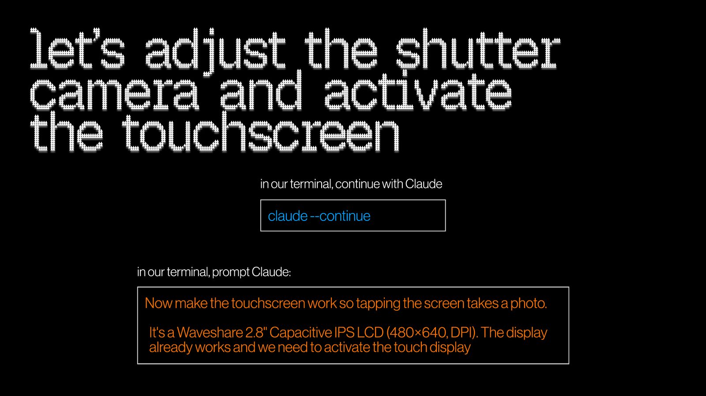

Once it works, change something:

```
now make it take the photo when I tap the screen instead
```

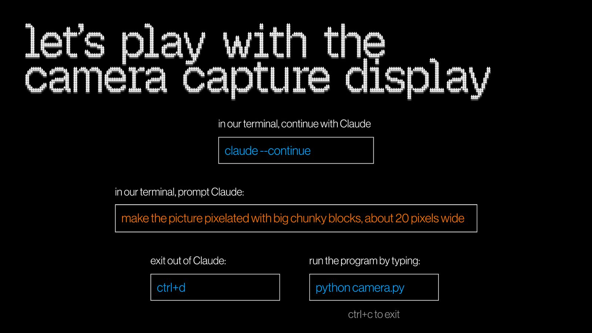

```
make the picture pixelated — big chunky blocks, about 20 pixels wide
```

Then change it again. Make the blocks 4 pixels instead of 20. Run it, look at the screen, tell Claude what you saw.

**That's the whole method: describe, run, look, change.**

---

## Ideas to start from

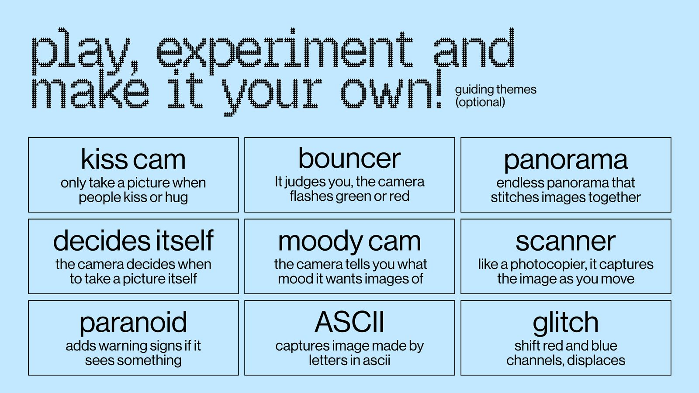

| | |
|---|---|
| **Kiss cam** | Finds two faces and decides something's happening |
| **Bouncer** | Judges you. Green light, red light, no explanation |
| **Hair ID** | Zooms into your hair and names the style, with total confidence |
| **Shy** | Only takes the photo when you look away |
| **Slit scan** | Builds the picture one line at a time, so moving smears you |
| **Ten seconds ago** | Shows you the past, never now |
| **ASCII** | Your face, made of letters |
| **Paranoid** | Draws boxes around everything and keeps a log |
| **Glitch** | Shifts the colour channels apart on purpose |

→ Full prompts for each in **[prompts.md](prompts.md)**

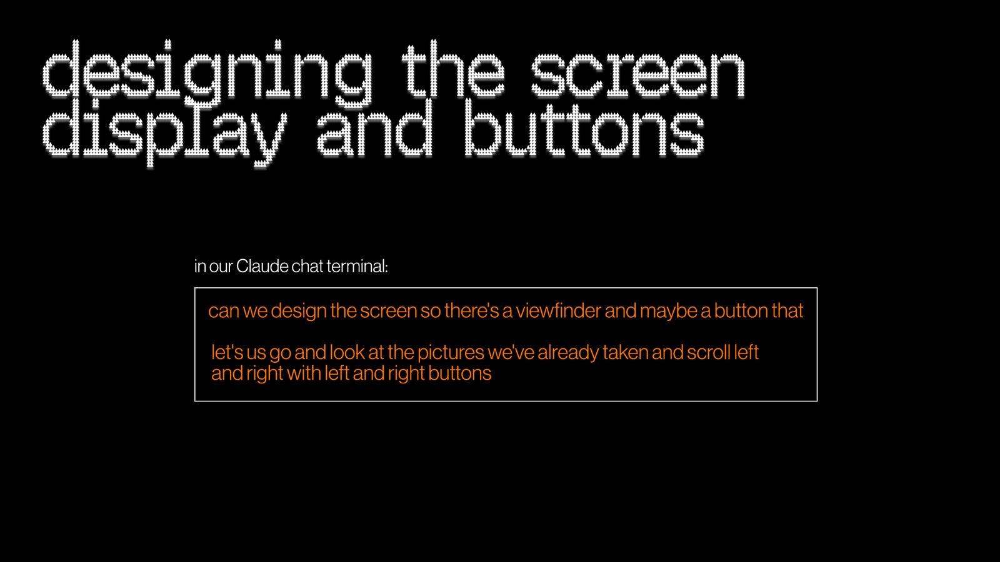

And when you want to make it feel like a real object, ask for the interface too — a viewfinder, a gallery you can scroll through, buttons on the touchscreen.

---

## Make it portable

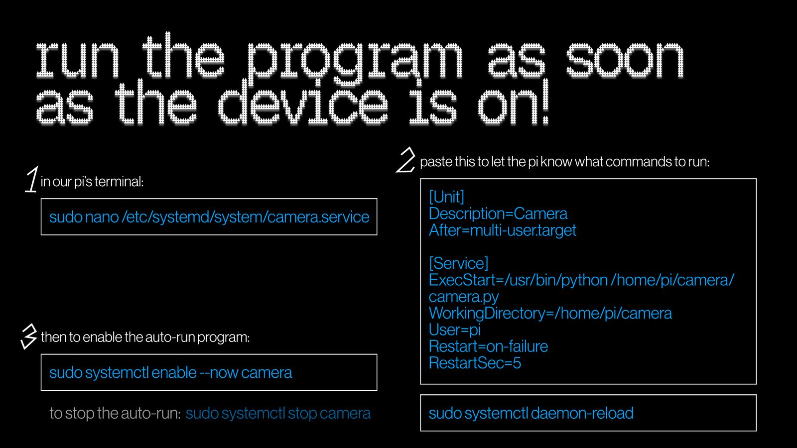

One last command, and your camera starts by itself every time you switch it on. No laptop, no wifi, nothing to type:

```bash
sudo systemctl enable --now camera
```

Unplug from the wall, switch the battery on, and hand it to someone.

When you want to change it again:

```bash
sudo systemctl stop camera
```

---

## Taking it somewhere else

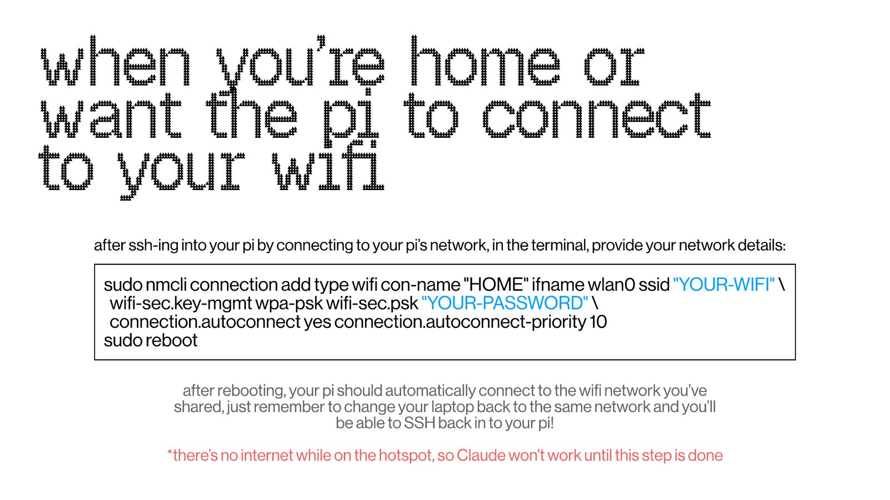

Your Pi only knows the wifi you set up at the start. If you take it somewhere new, you'll need a way back in — that's what **[at-home.md](at-home.md)** is for.

---

## When it breaks

It will, and that's fine. Nothing you type can permanently damage the Pi — worst case you re-flash the card and start again.

→ **[troubleshooting.md](troubleshooting.md)** has the errors I actually hit while making this.

---

Made by [Tigris](https://instagram.com/tigrisli), in partnership with Anthropic.
