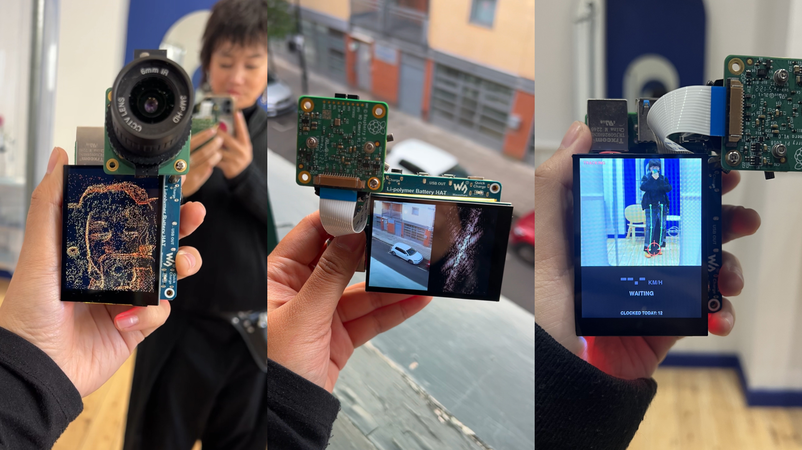

# Curious Machines

**Building hardware with Claude Code**

What could a screen, a camera, and a tiny computer become in your hands?

This is a series about giving your ideas physical form. Each project starts with a small pile of parts and playful experimentation to explore new concepts and let your imagination run free! We'll be stacking hardware together and implementing Claude Code into our Raspberry Pis.

Every guide here is meant to be a starting point for you to build on, break, and make into something of your own!

---

## 01 · What can a camera capture beyond images?

### → [Start here](01-camera/)

---

## More coming

**02 ·** Coming soon

**03 ·** Coming soon

---

Made by [Tigris](https://instagram.com/tigrisli), in partnership with [Claude](http://clau.de/tigrisli).
